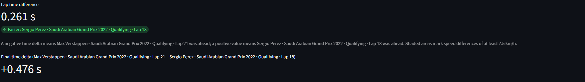
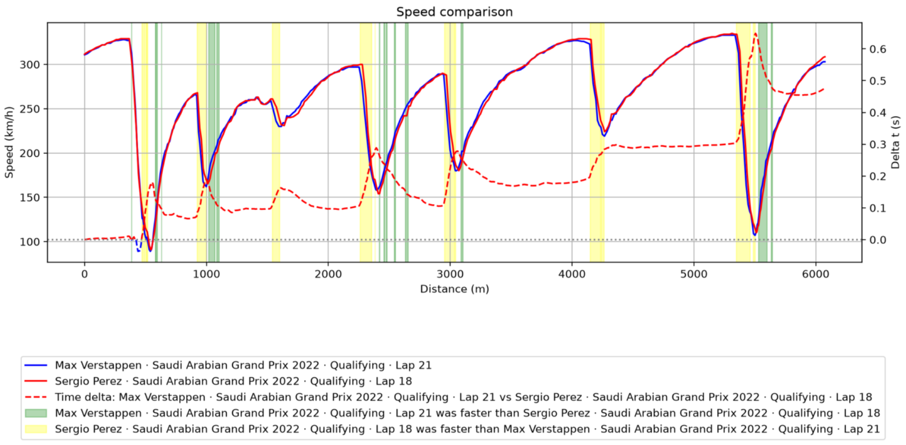
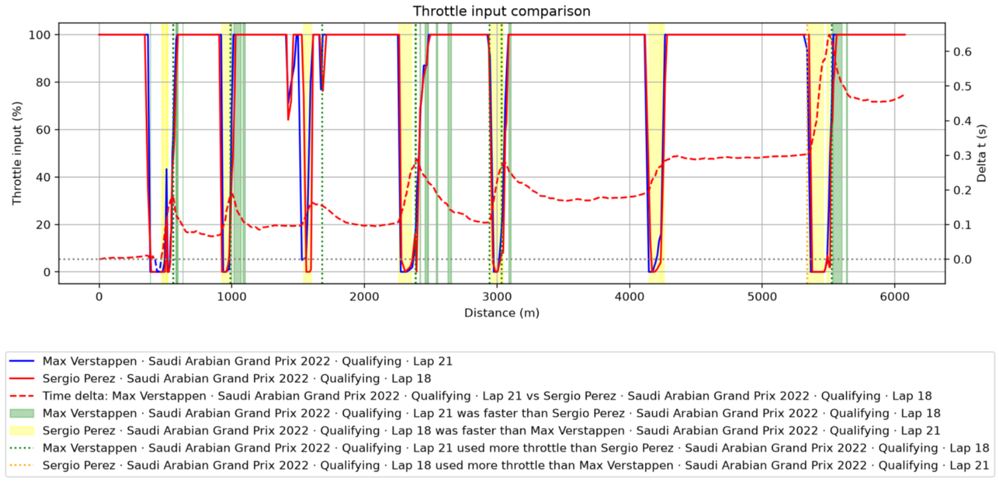
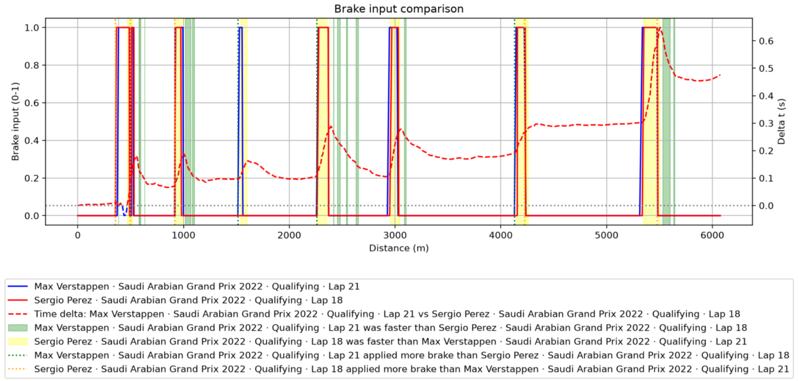

# F1 Lap Comparison Tool

F1 Lap Comparison Tool is a Python project for Formula 1 enthusiasts and analysts. It compares two laps using session and telemetry data from FastF1. Alongside the lap-time difference, it plots telemetry to help explore where the laps differ and which driver inputs may be related to those differences.

## Features

- Select two laps from Formula 1 sessions available through FastF1.
- Compare lap times and telemetry over the distance shared by both laps.
- Plot speed, throttle, brake, and time delta against distance.
- Highlight sections where the speed difference reaches at least 7.5 km/h.
- Mark selected throttle or brake differences that may help explain speed differences.
- Use either the command-line program or the Streamlit interface.

The Streamlit app currently uses one selected circuit for both laps. The years, sessions, drivers, and laps can be selected separately.

## Demo






## Technologies

- **Python** — programming language.
- **FastF1** — retrieves Formula 1 session, lap, and telemetry data.
- **Streamlit** — provides the web interface.
- **NumPy** — processes telemetry arrays and interpolates data by distance.
- **pandas** — filters and organizes lap data.
- **Matplotlib** — creates the comparison graphs.

## Requirements

- Python 3.
- An internet connection to retrieve data that is not already cached.
- The Python packages listed in [`requirements.txt`](requirements.txt).

## Installation

1. Clone or download this repository and open PowerShell in the project folder.
2. Create and activate a virtual environment:

   ```powershell
   py -m venv .venv
   .\.venv\Scripts\Activate.ps1
   ```

3. Install the dependencies:

   ```powershell
   python -m pip install --upgrade pip
   python -m pip install -r requirements.txt
   ```

## How to Use

### Streamlit app

Start the app from the project folder:

```powershell
python -m streamlit run f1_lap_comp_app.py
```

In the app, select a year for each lap and choose one circuit, which is used for both laps. Select a session for each lap and click **Load sessions**. Then choose a driver and lap in each session and click **Compare laps** to view the lap-time result and telemetry graphs.

### Command-line program

Run the interactive command-line version with:

```powershell
python f1_lap_comp.py
```

Follow the prompts to choose events, sessions, drivers, and laps.

## Data

The project uses Formula 1 lap and telemetry data provided by the FastF1 library. An internet connection is needed to download data that is not already available locally.

FastF1's data is stored in the `cache_dir` directory, which the programs create automatically. Cached data can make later analyses of the same sessions faster. The cache is excluded from Git and is not included when the repository is cloned.

Telemetry is aligned by distance, and the comparison is limited to the distance shared by both selected laps. The input-difference markers are heuristic indicators; they do not prove what caused a lap-time or speed difference.

## Project Structure

```text
F1_Lap_ComparsionTool/
├── f1_lap_comp.py         # Interactive command-line program
├── f1_lap_comp_app.py     # Streamlit web app
├── requirements.txt       # Python dependencies
├── LICENSE                # Custom source-available license
├── screenshots/           # README screenshots (add demo1.png to demo4.png)
├── cache_dir/             # FastF1 cache, created automatically and ignored by Git
├── README.md              # Project documentation
└── .gitignore             # Files and folders excluded from Git
```

## Limitations

The estimate of possible causes of speed differences is basic and can be misleading. Telemetry can be affected by conditions that this comparison does not account for, such as traffic, tyre state, fuel load, weather, and setup. The analysis could be expanded with more telemetry channels and a more detailed interpretation of the results.

## Contributions and Feedback

If you encounter a problem or have a suggestion, please open a GitHub issue or contact me at [eduardogomescamacho@gmail.com](mailto:eduardogomescamacho@gmail.com).

## License

This project uses a custom source-available license. You may view and run an unmodified copy for personal, non-commercial, educational, or evaluation purposes. Modification, redistribution, and commercial use are not permitted without prior written permission. See [`LICENSE`](LICENSE) for the full terms. This is not an open-source license. GitHub's Terms of Service may separately permit viewing and forking public repositories through GitHub.

## About Me

My name is Eduardo Camacho. I am a secondary school student from Portugal, and I hope to become a Formula 1 engineer.
